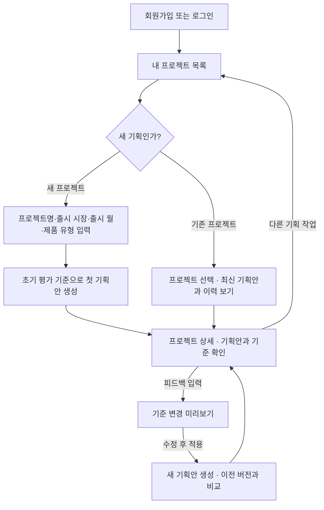
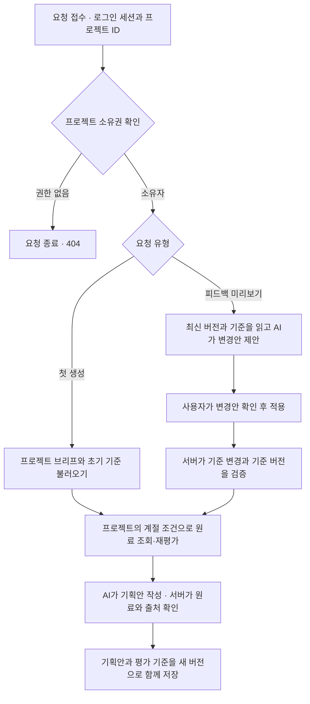
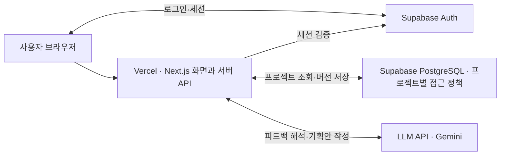
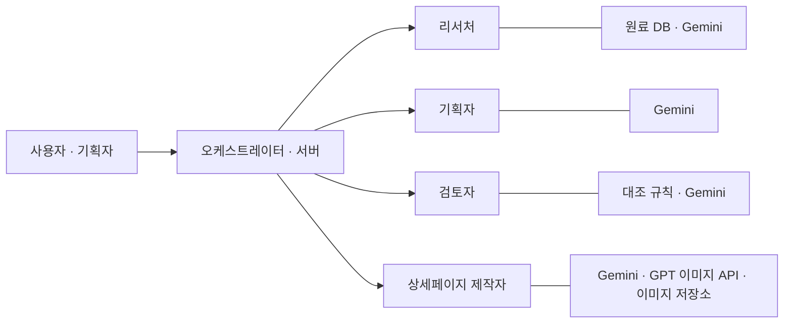

# PRD — 한방 유래 원료 기반 화장품 기획 도구

- 작성일: 2026-11-20
- 상태: 구현 완료. 확인한 범위와 남은 확인은 `PROGRESS.md`에 있다
- 2026-11-20 추가: 에이전트 구조, 프로세스 구조도, 상세페이지·상세이미지 ([13절](#13-에이전트-구조와-프로세스-구조도))
- 근거 자료: 다중 사용자·다중 프로젝트 설계 메모(2026-11-20), 폴더의 도식 3장
  - `유저플로우.png` — 로그인부터 프로젝트별 기획까지
  - `워크플로우.png` — 서버가 프로젝트의 기준을 읽고 바꾸는 절차
  - `시스템 구성도.png` — 로그인, 프로젝트 권한, 데이터 저장
- 4·6·7절의 흐름은 도식 3장과 같다. 도식에 없지만 이 문서가 정한 것은 [11절](#11-도식에-없지만-이-문서가-정한-것)에 모았다.

## 1. 제품 요약

화장품 기획자가 출시 시장·출시 월·제품 유형을 입력하면, 계절 조건에 맞는 한방 유래 원료 후보와 근거를 담은 기획안을 AI가 작성한다. 기획자는 피드백으로 평가 기준을 바꿔 가며 새 버전을 만들고 이전 버전과 비교한다.

한 사용자 계정에 프로젝트가 여러 개 있고, **평가 기준과 기획안 이력은 프로젝트마다 따로 저장한다.** 여름용 진정 젤크림 프로젝트에서 연구 근거 가중치를 올려도 겨울용 보습 크림 프로젝트에는 적용되지 않는다.

## 2. 목표와 범위

### 목표

1. 로그인한 사용자가 자기 프로젝트만 보고 수정한다.
2. 프로젝트마다 평가 기준과 기획안 버전 이력이 독립적으로 쌓인다.
3. 기획안에 실린 원료와 출처는 모두 원료 DB에 실제로 있는 것이다.
4. 어떤 버전을 열어도 그 버전을 만들 때 쓴 평가 기준을 볼 수 있다.

### 이번 범위에서 하지 않는 것

- 프로젝트 공유·팀 협업 (프로젝트 소유자는 1명)
- 최종안 채택, 근거 부족 안내 (이전 도식에 있었으나 교체된 도식에는 없다)
- Railway 백그라운드 워커 (자료 수집, 대량 생성이 필요해지면 추가)
- 원료 DB 관리 화면 (초기 데이터는 시드 SQL로 넣는다)
- 결제, 요금제, 관리자 화면
- 기획안 내보내기(PDF·문서)
- 상세페이지 문안에 대한 별도 검토, 상세이미지 다시 만들기

## 3. 사용자와 용어

| 용어 | 뜻 |
|---|---|
| 사용자 | 로그인한 화장품 기획자. 프로젝트의 소유자 |
| 프로젝트 | 기획 하나. 예: "여름용 진정 젤크림" |
| 브리프 | 프로젝트명, 출시 시장, 출시 월, 제품 유형 |
| 계절 조건 | 출시 시장과 월에서 나온 기후·피부 고민 조건. 원료 조회에 쓴다 |
| 평가 기준 | 필수 조건(후보를 걸러내는 조건)과 가중치(후보 순위를 정하는 비율) |
| 기획안 버전 | 생성에 성공한 기획안 1건. v1, v2 … 수정되지 않는다 |
| 현재 기준 | 그 프로젝트의 **최신 생성 완료 버전에 저장된 평가 기준**. 버전이 없으면 프로젝트의 초기 평가 기준 |
| 피드백 | 사용자가 특정 버전에 남긴 수정 요청. AI가 기준 변경안으로 해석한다 |

## 4. 유저플로우



### 화면

| 화면 | 경로(안) | 내용 |
|---|---|---|
| 로그인·회원가입 | `/login` | 로그인 후 `/projects`로 이동 |
| 내 프로젝트 목록 | `/projects` | 로그인 후 첫 화면. 프로젝트명, 제품 유형, 출시 월, 최신 버전 번호 |
| 새 프로젝트 | `/projects/new` | 브리프 입력 → 첫 기획안 생성 |
| 프로젝트 상세 | `/projects/[id]` | 현재 평가 기준, 최신 기획안, 버전 이력, 피드백 입력 |
| 버전 보기·비교 | `/projects/[id]/versions/[no]` | 직전 버전이 있으면 두 기획안을 좌우로 나란히 놓는다. 평가 기준, 콘셉트, 원료 후보, 추천 이유, 확인할 점, 검토 결과, 상세페이지를 부분별로 같은 높이에 맞추고, 왼쪽이 직전 버전, 오른쪽이 그 버전이다. 맨 위에 바뀐 기준을 모아 보여 준다. v1은 비교 대상이 없어 한 버전만 나온다 |

- 첫 기획안이 없는 프로젝트를 다시 열면 입력한 브리프와 초기 평가 기준을 이어서 확인하고 초안을 생성한다.
- 기준 변경 미리보기에는 바뀌는 항목만 `25% → 40%` 형식으로 보여 준다. 사용자는 값을 고친 뒤 적용할 수 있다.

## 5. 기능 요구사항

### F1. 인증
- Supabase Auth의 Email sign-in provider로 회원가입·로그인·로그아웃한다. 이메일과 비밀번호를 쓴다.
- 비밀번호 저장과 세션 발급은 Supabase에 맡긴다. 자체 인증 로직이나 사용자 테이블을 만들지 않는다.
- 로그인하지 않은 사용자는 `/login` 외의 화면과 API에 접근할 수 없다.

### F2. 프로젝트
- 사용자는 프로젝트를 여러 개 만들 수 있다. 개수 제한은 두지 않는다.
- 생성 시 프로젝트명, 출시 시장, 출시 월, 제품 유형을 받는다.
- 서버가 브리프에서 계절 조건과 초기 평가 기준을 정해 `projects.initial_criteria`에 저장한다. 사용자는 프로젝트 상세에서 기준을 확인하고 피드백으로 바꾼다.
- 목록에는 자기 프로젝트만 나온다.

### F3. 첫 기획안 생성
- 프로젝트의 브리프와 초기 평가 기준으로 v1을 만든다.
- 생성 절차는 [6절](#6-워크플로우)의 공통 생성 단계를 따른다.

### F4. 피드백과 기준 변경 미리보기
- 사용자가 최신 버전에 피드백을 글로 남긴다.
- AI가 피드백을 **기준 변경안**(필수 조건 추가, 가중치 조정)으로 바꿔 제안한다. 이 단계에서는 아무 기준도 바뀌지 않는다.
- 피드백 원문과 변경안은 `feedback`에 `proposed` 상태로 저장한다.

### F5. 적용 후 새 버전 생성
- 사용자가 변경안을 확인(필요하면 수정)하고 적용하면, 서버가 변경된 기준을 검증하고 새 버전을 만든다.
- 생성에 성공하면 기획안과 그때의 평가 기준을 **한 트랜잭션으로** 새 버전에 저장하고, 피드백을 `applied`로 바꾸며 생성된 버전을 연결한다.
- 생성에 실패하면 아무것도 저장하지 않는다. 현재 기준은 그대로이고 피드백은 `proposed`로 남아 다시 시도할 수 있다.

### F6. 버전 이력과 비교
- 프로젝트의 모든 버전을 번호순으로 볼 수 있다.
- 버전을 열면 그 버전의 기획안과 **생성 시점의 평가 기준**이 나온다.
- 직전 버전과 기획안 전체를 좌우로 나란히 보여 준다. 원료 후보 표에는 새로 들어온 원료, 빠진 원료, 순위 변동을 표시한다.

## 6. 워크플로우



### 역할 분담

| 단계 | 담당 | 이유 |
|---|---|---|
| 소유권 확인 | 서버 + RLS | 프로젝트 ID를 바꿔 요청해도 다른 사용자의 데이터가 열리지 않아야 한다 |
| 피드백 → 변경안 | LLM | 자연어 해석 |
| 변경안 검증 | 서버 | 가중치 합 100, 알려진 기준 키만 허용, 기준 버전이 최신인지 확인 |
| 원료 조회·필터링·점수 계산·순위 | 서버 | 같은 기준이면 같은 순위가 나와야 한다 |
| 기획안 문장·추천 이유 | LLM | 서버가 정한 후보와 근거만 입력으로 받는다 |
| 원료 ID·출처 대조 | 서버 | LLM이 DB에 없는 원료나 출처를 쓰면 저장을 거부한다 |

### 예시 — 여름 젤크림 프로젝트

1. v1의 연구 근거 가중치가 25%다.
2. "연구 근거를 더 중요하게 봐 줘"라는 피드백을 남기면 미리보기에 `연구 근거 25% → 40%`가 나온다. 합이 100이 되도록 다른 가중치도 함께 조정된 값이 표시된다.
3. 적용 후 생성에 성공하면 v2의 기준으로 40%가 저장된다.
4. 이 프로젝트의 다음 피드백은 40%에서 시작한다.
5. v1을 열면 당시의 25%가 보인다.
6. 같은 사용자의 겨울 보습 크림 프로젝트는 영향을 받지 않는다.

### 동시 수정

두 탭에서 같은 v1을 놓고 각각 피드백을 적용할 수 있다. 서버는 새 버전을 저장할 때 **기준이 된 버전이 여전히 최신인지** 확인한다.

- 요청에 `base_version_id`를 담는다.
- 저장 시 `(project_id, version_no)` 유일 제약으로 같은 번호의 버전이 두 번 들어가지 못하게 한다.
- 늦게 도착한 요청은 409로 거절하고, 화면은 "다른 곳에서 새 버전이 만들어졌습니다. 최신 버전을 확인해 주세요"를 보여 준다.

## 7. 시스템 구성



| 구성 요소 | 역할 |
|---|---|
| Vercel · Next.js | 화면, 서버 API. LLM 키는 서버에만 둔다 |
| Supabase Auth | 회원가입, 로그인, 세션 |
| Supabase PostgreSQL | 프로젝트, 버전, 피드백, 원료. RLS로 접근 제한 |
| LLM API | Gemini API, 모델 `gemini-3.8-flash`. 피드백 해석, 근거 정리, 기획안 작성, 검토, 상세페이지 문안 |
| 이미지 API | OpenAI 이미지 API, 모델 `gpt-image-2.5-flare`. 상세이미지 생성 |
| Supabase Storage | 비공개 버킷 `detail-images`. 상세이미지 파일 |
| Railway (나중에) | 자료 수집·대량 생성처럼 웹 요청과 따로 돌릴 작업이 생기면 워커로 추가 |

## 8. 데이터 모델

### 테이블

| 테이블 | 연결 기준 | 들어가는 내용 |
|---|---|---|
| `projects` | `owner_id` → 로그인 사용자 ID | 프로젝트명, 출시 시장·월, 제품 유형, 초기 평가 기준 |
| `plan_versions` | `project_id` → 프로젝트 | 버전 번호, 기획안, 원료 후보와 근거, 생성 시점의 평가 기준 |
| `feedback` | `base_version_id` → 피드백을 남긴 버전 | 피드백 원문, 제안된 기준 변경, 적용 상태, 생성된 버전 |
| `ingredients` | 모든 프로젝트가 공통으로 조회 | 한방 유래 원료명, 특성, 출처와 근거 |

### 스키마

실제 정의는 `supabase/migrations/0001_init.sql`에 있다. 위 표와 다른 점만 적는다.

- `projects.owner_id`의 기본값은 `auth.uid()`다.
- `ingredients.id`는 uuid가 아니라 `centella-asiatica` 같은 글자 ID다. LLM이 ID를 그대로 옮겨 쓰기 쉽고, 시드를 다시 실행해도 같은 행을 덮어쓴다.
- 출처마다 `centella-asiatica:s1` 형식의 ID가 있다. 기획안은 출처를 이 ID로 가리킨다.
- `plan_versions.candidates`에는 생성 시점의 원료명·점수·출처를 그대로 복사해 둔다. 나중에 원료 DB가 바뀌어도 이전 버전은 당시 내용으로 보인다.

### 평가 기준 JSON

```json
{
  "season": { "climate": "hot_humid", "concerns": ["soothing", "sebum", "antioxidant"] },
  "required": ["concern_match"],
  "weights": {
    "research_evidence": 25,
    "season_fit": 30,
    "formulation_fit": 25,
    "market_appeal": 20
  }
}
```

- `weights`는 네 항목 모두 0~100의 정수이고 합은 항상 100이다. 서버가 검증한다.
- `season.climate`은 출시 시장과 출시 월로 정해지며 피드백으로 바꿀 수 없다. `season.concerns`, `required`, `weights`는 피드백으로 바꿀 수 있다.
- 키와 화면 표시 이름은 `lib/criteria.ts`, `lib/domain.ts`에 있다.

| 종류 | 키 | 뜻 |
|---|---|---|
| 가중치 | `research_evidence` | 연구 근거 |
| 가중치 | `season_fit` | 계절 적합성 |
| 가중치 | `formulation_fit` | 제형 적합성 |
| 가중치 | `market_appeal` | 시장 선호 |
| 필수 조건 | `concern_match` | 계절 피부 고민 중 하나 이상에 해당하는 효능 |
| 필수 조건 | `evidence_strong` | 연구 근거 4등급 이상 |
| 필수 조건 | `low_irritation` | 자극 우려 2 이하 |
| 기후 | `hot_humid`, `hot_dry`, `temperate`, `cold_dry` | 고온다습, 고온건조, 온화, 저온건조 |
| 피부 고민 | `soothing`, `sebum`, `hydration`, `barrier`, `brightening`, `antiaging`, `antioxidant` | 진정, 피지·모공, 보습, 장벽 강화, 톤 개선, 탄력·주름, 항산화 |

### 원료 데이터와 점수 계산

원료 32건을 `supabase/seed/ingredients.mjs`에 정리했고, `npm run seed:build`가 `ingredients.sql`을 만든다.

| 원료 특성 (`traits`) | 값 | 쓰이는 곳 |
|---|---|---|
| `evidence` | 1~5 | 연구 근거 점수, `evidence_strong` |
| `irritation` | 1(낮음)~5 | `low_irritation` |
| `concerns` | 피부 고민 키 목록 | 계절 적합성 점수, `concern_match` |
| `climate` | 기후별 1~5 | 계절 적합성 점수 |
| `formulation` | 제형별 1~5 (수분, 유화, 오일, 씻어내는) | 제형 적합성 점수 |
| `market` | 시장별 1~5 | 시장 선호 점수 |

점수는 모두 0~100이다.

- 연구 근거 = `evidence` ÷ 5 × 100
- 계절 적합성 = (기후 적합도 ÷ 5 × 100) × 0.5 + (맞는 피부 고민 수 ÷ 기준의 피부 고민 수 × 100) × 0.5
- 제형 적합성 = 제품 유형이 속한 제형의 적합도 ÷ 5 × 100
- 시장 선호 = 출시 시장의 선호도 ÷ 5 × 100
- 총점 = 네 점수를 가중치로 평균한 값. 동점이면 원료 ID순이다.

필수 조건을 통과한 원료를 총점순으로 세우고 상위 5개를 기획안에 싣는다. 통과한 원료가 3개 미만이면 생성하지 않는다.

출처는 세 종류다. 공정서(대한민국약전·생약규격집 수재 여부), 성분 명칭(INCI), 문헌 요약(지표 성분과 보고된 작용). 일부 원료에는 규제 출처(식약처 기능성화장품 고시)가 더 있다. **근거 등급과 적합도 점수, 문헌 요약은 초기 기획 검토용으로 정리한 값이고 1차 문헌 서지가 아니다.** 실제 제품 기획에 쓰기 전에 연구·규제 담당자가 확인해야 한다.

출시 시장은 8곳(한국, 일본, 중국, 미국, 유럽, 동남아시아, 중동, 호주·뉴질랜드), 제품 유형은 9종(토너, 세럼·에센스, 젤크림, 시트 마스크, 크림, 선케어, 페이스 오일·밤, 클렌저, 워시오프 마스크)이다. 시장과 월로 기후를 정하는 표는 `lib/domain.ts`에 있고, 남반구인 호주·뉴질랜드는 계절이 반대다.

### 규칙

- `plan_versions`는 넣기만 하고 고치지 않는다. 수정·삭제 정책을 만들지 않는다.
- 새 버전 저장과 피드백 상태 변경은 Postgres 함수 하나로 묶어 한 트랜잭션에서 처리한다.
- 현재 기준을 따로 저장하는 열은 두지 않는다. 항상 최신 버전의 `criteria`에서 읽는다.

### 접근 정책 (RLS)

정책 정의는 `supabase/migrations/0001_init.sql`에 있다.

- `projects`는 `owner_id`가 로그인한 사용자 ID와 같을 때만 읽고 쓸 수 있다.
- `plan_versions`와 `feedback`은 연결된 프로젝트의 소유권을 따라간다. `plan_versions`에는 읽기와 넣기 정책만 있다.
- `ingredients`는 로그인한 사용자가 읽기만 한다. 원료는 사용자가 Supabase SQL Editor에서 시드 SQL을 실행해 넣는다.
- 서버 API는 사용자 세션으로 Supabase에 접속한다. 앱은 서비스 키를 쓰지 않는다.
- 버전 저장 함수 `create_plan_version`은 호출한 사용자의 권한으로 실행된다.

## 9. 서버 API

| 메서드·경로 | 하는 일 | 주요 오류 |
|---|---|---|
| `POST /api/projects` | 프로젝트 생성. 브리프를 받아 초기 평가 기준과 함께 저장 | 401, 422 |
| `POST /api/projects/[id]/versions` | 새 버전 생성. 첫 생성 본문: `base_version_id: null` (프로젝트의 초기 기준을 쓴다). 피드백 적용 본문: `base_version_id`, `feedback_id`, `criteria` | 404, 409, 422, 502 |
| `POST /api/projects/[id]/feedback` | 피드백 미리보기. 본문: `base_version_id`, `body` → `feedback_id`, `criteria`(변경 후 기준 전체), `summary` | 404, 409, 422, 502 |

- 목록·상세·버전 조회는 서버 컴포넌트에서 Supabase를 직접 읽는다.
- 소유자가 아닌 프로젝트는 403이 아니라 404로 응답한다. 프로젝트가 있는지도 알려 주지 않는다.
- 로그인하지 않은 API 요청은 401이다.
- 버전 생성과 피드백 미리보기는 입력 확인까지만 일반 JSON 오류(401·404·409·422)로 답한다. 그 뒤로는 진행 이벤트를 한 줄에 하나씩(NDJSON) 흘려보내고, 마지막 줄의 `status`에 결과 코드를 담는다. 13절 참고.
- 422는 입력이 잘못됐거나 원료 후보가 3개 미만일 때(`insufficient_candidates`)다.
- 502는 Gemini 호출이 실패했거나(`llm_error`), AI가 쓴 기획안이 원료 DB와 맞지 않을 때(`plan_rejected`)다. 어느 쪽이든 저장하지 않는다.
- AI가 제안한 변경안은 허용된 키만 남기고 가중치 합을 100으로 맞춘 뒤 미리보기에 보여 준다. 사용자가 적용할 때 보낸 기준은 맞추지 않고 그대로 검증한다.

## 10. 결정한 사항

구현 전에 비어 있던 항목이다. Q2·Q3은 사용자가 정했고, 나머지는 글로벌 화장품 기획자가 쓰는 도구라는 전제로 구현하면서 정했다.

| # | 질문 | 결정 |
|---|---|---|
| Q1 | 원료 데이터의 출처와 구조 | 한방 유래 원료 32건을 시드로 정리. 특성 6종과 출처 2~4건. 자세한 내용은 8절 |
| Q2 | LLM 제공사와 모델 | Gemini API, `gemini-3.8-flash` |
| Q3 | 로그인 방식 | 이메일·비밀번호. Supabase Auth의 Email sign-in provider |
| Q4 | 초기 평가 기준을 어떻게 정하는가 | LLM 없이 코드로 정한다. 가중치는 연구 근거 25·계절 적합성 30·제형 적합성 25·시장 선호 20, 필수 조건은 `concern_match`, 계절 조건은 시장과 월에서 계산 |
| Q5 | 원료 후보가 없거나 적을 때 | 필수 조건을 통과한 원료가 3개 미만이면 422로 멈추고 저장하지 않는다. LLM도 부르지 않는다 |
| Q6 | 지원하는 출시 시장과 제품 유형 | 시장 8곳, 제품 유형 9종을 고정 목록에서 고른다. 8절 |
| Q7 | 생성 시간과 워커 도입 시점 | 버전 하나에 Gemini 호출 한 번. 함수 제한 시간은 60초, Gemini 호출은 50초에서 끊는다. Railway 워커는 넣지 않았다 |

## 11. 도식에 없지만 이 문서가 정한 것

도식과 설계 메모에는 없고, 구현하려면 정해야 해서 이 문서에서 채운 내용이다. 검토할 때 이 표를 먼저 봐 주면 된다.

| 항목 | 이 문서의 선택 | 위치 |
|---|---|---|
| 가중치 합 | 항상 100. 하나를 올리면 나머지를 함께 조정한 값을 미리보기에 표시 | 8절 |
| 평가 기준 구조 | 계절 조건, 필수 조건, 가중치 세 부분의 JSON. 가중치 4종, 필수 조건 3종 | 8절 |
| 권한 없음 응답 | 403이 아니라 404 | 9절 |
| 동시 수정 응답 | 늦은 요청은 409 | 6절 |
| 점수 계산 담당 | 서버가 순위를 정하고 LLM은 문장만 쓴다 | 6절 |
| 생성 실패 시 피드백 | `proposed`로 남겨 다시 시도 가능. 미리보기에서 취소하면 `discarded` | F5 |
| 기획안 검증 | 후보 5개 모두에 추천 이유가 있고, 이유마다 그 원료의 출처 ID가 하나 이상 있어야 저장 | 6절 |
| 가입 확인 메일 | 링크가 `/auth/callback`으로 돌아와 세션을 만든다 | F1 |
| 피드백 상태값 | `proposed`, `applied`, `discarded` | 8절 |

## 12. 수용 기준

1. 사용자 A로 만든 프로젝트 ID를 사용자 B의 세션으로 요청하면 화면과 API 모두 404가 나온다.
2. 프로젝트 X에서 가중치를 바꿔 v2를 만든 뒤 프로젝트 Y를 열면 Y의 현재 기준은 그대로다.
3. v2를 만든 뒤 v1을 열면 v1 생성 당시의 기준이 보인다.
4. 생성 도중 LLM 호출이 실패하면 `plan_versions`에 새 행이 없고, 프로젝트 상세의 현재 기준과 최신 기획안이 실패 전과 같다.
5. 두 탭에서 같은 v1을 기준으로 적용하면 하나만 v2가 되고 다른 하나는 409를 받는다.
6. 저장된 모든 버전의 원료 ID는 `ingredients`에 있고, 실린 출처는 그 원료의 `sources`에 있다.
7. 가중치 합이 100이 아닌 기준으로 적용을 요청하면 422가 나온다.

## 13. 에이전트 구조와 프로세스 구조도

### 에이전트

기획안 하나를 만들 때 오케스트레이터가 네 에이전트에게 차례로 일을 넘긴다. 오케스트레이터 자체는 서버 코드이고, AI를 쓰는 단계와 서버가 계산하는 단계를 화면에서 `AI`·`서버` 표시로 구분한다.



| 에이전트 | 단계 | 담당 | 하는 일 |
|---|---|---|---|
| 오케스트레이터 | 요청 접수 · 소유권 확인 | 서버 | `projects`를 읽어 소유자인지 확인 |
| | 평가 기준 확인 | 서버 | 현재 기준과 요청한 기준을 비교 |
| | 피드백 해석 | AI (Gemini) | 피드백 글을 기준 변경안으로 바꿈 |
| | 변경안 검증 · 저장 | 서버 | 허용된 값만 남겨 `feedback`에 저장 |
| | 새 버전 저장 | 서버 | `plan_versions`에 행 추가, `feedback` 상태 변경 |
| 리서처 | 원료 조회 · 점수 계산 | 서버 | `ingredients`를 읽어 필터링·순위 |
| | 근거 정리 | AI (Gemini) | 후보별 근거 메모. 후보·출처와 맞지 않는 부분은 버린다 |
| 기획자 | 기획안 작성 | AI (Gemini) | 콘셉트, 타깃, 소구점, 원료별 추천 이유 |
| | 검토 의견 반영 | AI (Gemini) | 검토자가 돌려보냈을 때 한 번 고쳐 쓴다 |
| 검토자 | 원료 · 출처 대조 | 서버 | 원료 ID·출처 ID가 후보와 어긋나면 저장하지 않는다 |
| | 표현 · 근거 검토 | AI (Gemini) + 서버 | 의약품 오인 표현, 출처에 없는 단정, 후보 밖 원료 언급을 점검. 후보 밖 원료의 이름은 서버도 글에서 찾는다 |
| 상세페이지 제작자 | 상세페이지 문안 작성 | AI (Gemini) | 헤드라인, 부제, 섹션 3개(제품 첫인상·핵심 원료·사용감과 사용법)의 문안과 이미지 지시문 |
| | 상세이미지 생성 | AI (GPT 이미지 API) | 섹션마다 1장. 1024×1536. 저장소에 올린다 |

- 검토자가 통과시키지 않으면 기획자가 **한 번** 고쳐 쓰고 다시 검토받는다. 그래도 의견이 남으면 더 돌리지 않고, 남은 의견을 기획안의 "검토 결과"에 적어 저장한다.
- 원료·출처 대조에 실패하거나 Gemini 호출이 실패하면 아무것도 저장하지 않는다.
- **상세이미지 생성은 실패해도 기획안 저장을 막지 않는다.** 실패한 섹션은 문안만 싣는다. OpenAI 키가 없을 때도 같다.
- 이미지에는 글자를 넣지 않는다. 문안은 화면에서 이미지 아래에 글자로 얹는다.
- 리서처 메모, 검토 결과, 상세페이지는 `plan_versions.plan` 안에 `research`, `review`, `detail_page`로 함께 저장한다. 테이블 구조는 바뀌지 않았다.

### 상세이미지 저장

- 비공개 버킷 `detail-images`에 `{사용자 ID}/{프로젝트 ID}/{실행 ID}/{번호}.png`로 올린다. 첫 폴더가 자기 ID인 파일만 읽고 쓸 수 있다 (`supabase/migrations/0002_detail_images.sql`).
- 화면에 보여 줄 때마다 서버가 1시간짜리 주소를 만든다.
- 버전 저장에 실패하면 그 실행에서 올린 이미지를 지운다.

### 프로세스 구조도

프로젝트 상세 화면의 왼쪽은 기획안, 오른쪽은 프로세스 구조도다.

- 사용자가 "첫 기획안 생성", "기준 변경 미리보기", "적용하고 새 기획안 생성"을 누르면 서버가 단계마다 시작·완료 이벤트를 보낸다.
- 지금 일하는 에이전트, 그 단계, 쓰는 도구(Gemini, GPT 이미지 API, 원료 DB 등)가 형광색으로 깜빡인다. 움직임 줄이기 설정을 켠 기기에서는 깜빡이지 않고 색만 바뀐다.
- 에이전트 상자마다 아래에 두 줄 높이의 로그 칸이 있다. 그 에이전트가 지금 하는 일과 방금 끝낸 일이 최신순으로 나오고, 넘치면 칸 안에서 스크롤한다.
- 오케스트레이터에서 각 에이전트로, 에이전트에서 도구로 연결선이 있다. 일하는 에이전트로 가는 선은 형광색이 된다.
- 저장소 줄은 이번 실행에서 읽거나 쓴 테이블을 `읽기`·`행 추가`·`값 변경`으로 표시한다.
- 작업 기록은 단계마다 한 일, 다룬 테이블과 열, 기준이 바뀐 값(`연구 근거 25% → 40%`)을 최신순으로 쌓는다.
- 새 프로젝트를 만들면 상세 화면으로 넘어가 첫 기획안 생성을 바로 시작한다.

피드백을 보냈을 때 기준이 어디서 바뀌는지는 이렇게 보인다.

| 누른 버튼 | 쓰는 테이블 | 기록에 나오는 내용 |
|---|---|---|
| 기준 변경 미리보기 | `feedback` 행 추가 | `proposed_changes` 열에 변경안 저장. `plan_versions`는 건드리지 않음. 바뀔 값 `25% → 40%` |
| 적용하고 새 기획안 생성 | `plan_versions` 행 추가, `feedback` 값 변경 | 새 버전 행의 `criteria` 열에 바뀐 기준 저장. 이전 버전 행은 그대로. `feedback.status`는 `proposed → applied` |

### 수용 기준 (추가)

9. 버전 생성 중 진행 이벤트가 리서처 → 기획자 → 검토자 → 상세페이지 제작자 → 저장 순으로 오고, 시작한 단계는 모두 끝난다.
10. 피드백 미리보기의 이벤트는 `feedback` 테이블에만 쓴다고 알리고, 바뀔 기준 값을 담는다.
11. 저장된 기획안에 상세페이지 문안이 들어 있고, 상세이미지 경로는 그 사용자의 폴더 아래다.
12. 상세이미지 생성이 실패해도 버전은 저장된다. 저장 단계가 실패하면 올린 이미지를 지운다.

